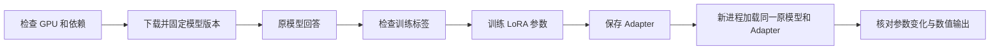

# M1 入门教程

这份教程带你完成原模型推理、一次小样本 LoRA 训练，以及保存后重新加载。你先理解并复跑这些步骤；不需要先学会实现 Transformer，也不需要租服务器或填写大模型 API key。

所有命令都在你自己的电脑执行。下面的训练只是确认流程可用，12 条示例和 8 次更新不构成聊天质量评测，也不是正式求职项目的全部成果。

## 1 先认识这次实验

### 1.1 你的设备与我们的选择

当前电脑是 Apple M4、16GB 统一内存，系统为 macOS 26。我们选择：

| 项目 | 当前选择 | 为什么 |
|---|---|---|
| 基础模型 | Qwen/Qwen2.5-1.5B-Instruct | 支持中文、体积适合入门、已有聊天能力，M1 不追求最新或最大模型 |
| 计算设备 | 苹果 GPU，通过 PyTorch MPS 使用 | 直接用你现有电脑完成学习流程 |
| 训练框架 | Transformers Trainer + PEFT | 现成训练循环和 LoRA 实现，代码与参数较容易阅读 |
| 参数适配 | 普通 LoRA，rank=8 | 先学习最直接的参数高效微调方式 |
| 数据 | 12 条中文教学示例 | 很快检查数据、训练和保存流程；M2 再准备正式数据 |
| 基础权重精度 | GPU 上 bfloat16 | 每个基础权重约用 2 字节，保留较大的数值范围；本机 float16 初次推理异常，因此改用此精度 |
| 随机性 | seed=42，生成时贪心解码 | 尽量减少流程验证时的随机因素，不保证跨设备完全一致 |

PRD 原先暂定 Unsloth Notebook。M1 根据实际设备改为复用 Hugging Face 官方 API；训练算法仍来自开源库，不是自己写训练引擎。这里不笼统认定 Unsloth 所有 macOS 功能都不可用；选择这条路线是为了学习透明度和当前环境的可验证性。

**bfloat16 不是 QLoRA。** 本次没有将基础模型量化到 4-bit。简历如果以后描述这次实验，应该写 LoRA，不能把它写成已做 QLoRA。

float16 和 bfloat16 都是 16 位浮点格式，但分配给数值范围与精细程度的位数不同。bfloat16 能表示更大的数值范围，通常更适合避免某些训练或推理的溢出；它也不是“精度全面更高”。本次选择以实际推理和训练验证为依据。

模型基础权重约 3GB；依赖、缓存和实验产物还会占用空间。首次下载需要联网，后面的模型运行读取本地文件。模型在本机计算，不会把问题发送给云端模型 API。

### 1.2 三种容易混淆的操作

- Prompt：改变本次输入，告诉模型怎样回答，不更新模型参数。
- 推理：模型读取输入并生成回答，不学习这条消息。
- 微调：用“问题 + 目标回答”计算训练误差，再更新可训练参数。

下载模型不等于训练，调用模型 API 也不等于训练。只有实际更新参数，才发生了微调。

### 1.3 这次的路线



## 2 打开终端并进入项目

打开 macOS 的“终端”应用，复制下面这一行，按回车：

```bash
cd "/Users/jakiimo/Desktop/AI Waifu"
```

路径包含空格，所以外面要有双引号。后面所有命令都在这个目录执行。

当前项目已创建独立 Python 环境 `.venv`。每条命令写 `.venv/bin/python`，是为了明确使用项目依赖，不混用系统的 Python 3.14。

你可以先运行：

```bash
.venv/bin/python --version
.venv/bin/python -m pip check
```

第一条应显示 Python 3.12.x；第二条正常时显示依赖没有冲突。`python -m pip` 表示让这个 Python 调用属于自己的包管理工具。

这台电脑上的首次验证已经完成，详见 [真实验证记录](M1_验证记录.md)。你可以复跑环境、原模型、标签检查和重载步骤；当前已有 Adapter，训练步骤会拒绝覆盖。先理解已有结果，再建立新实验即可。

如果未来重新建立环境，需要使用 Python 3.12：

```bash
python3.12 -m venv .venv
.venv/bin/python -m pip install -r requirements-lock.txt
```

以上是未来重建的说明，不要求你现在删除或重建已有环境。如果电脑没有 `python3.12` 命令，先安装相应版本或使用本次已有环境；不要直接用系统 `python3` 替代而忽略版本差异。

## 3 第一步 检查设备

```bash
.venv/bin/python scripts/m1.py doctor
```

预期看到：

```text
"device": "mps"
"mps_available": true
"tensor_check": [2.0, 2.0]
```

MPS 是 PyTorch 使用苹果 GPU 的接口。`tensor_check` 是实际在设备上做一次很小的计算，不仅是读取“是否支持”的标志。

本步把记录写到 `results/m1/environment.json`。如果只检测到 CPU，先不要继续大模型训练，应检查 Python、PyTorch 和设备访问情况。

## 4 第二步 下载模型

```bash
.venv/bin/python scripts/m1.py download
```

这一步需要联网，首次耗时由网络速度决定。已下载时重复执行会使用本地下载缓存；中断后重新运行同一命令即可。

模型不只是一个 Python 类，它包含：

- 权重文件：已经训练好的数字参数。
- Tokenizer：把文字转成 token 编号，也把编号还原为文字。
- 配置：层数、维度、词表等模型结构信息。
- Chat Template：system、user、assistant 消息怎样组织成模型输入。

代码会先查询模型的 commit，再固定下载这个版本，把记录放在 `models/model_manifest.json`。这样后面训练和重新加载使用同一套基础权重，不会悄悄换成另一版本。

**本项目的“原模型”是未经我们微调的 Instruct 模型。** 它已经被 Qwen 团队训练成能遵循指令的聊天模型，不是从随机参数开始，也不是另一款预训练 Base 模型。

## 5 第三步 看原模型回答

```bash
.venv/bin/python scripts/m1.py baseline
```

问题和角色提示词在 `configs/m1.json`。默认问题是“今天学习了一下午，但感觉什么都没学会，我该怎么办？”。

预期看到“原模型回答”和一段中文，记录保存在 `results/m1/baseline.json`。

本步发生的是：

1. 加载权重和 Tokenizer。
2. 把角色设定与用户问题应用聊天模板。
3. 模型预测下一个 token，再根据已经生成的内容继续预测。
4. 遇到结束符或达到最大生成长度后停止。

`do_sample=False` 表示每次选择当前概率最大的 token，称为贪心解码。它方便比较保存与重载的结果，暂不代表最终聊天产品最佳的生成方式。

M1 的生成上限是 96 token，回答可能在中途截断；这只是限制验证耗时，正式产品和评测会另行确定适当长度。token 不等于汉字数量。

如果回答已经符合角色要求，也很正常：原模型会遵循 Prompt。后面仍然需要比较强 Prompt 与微调的额外收益。

## 6 第四步 看清楚模型学什么

先打开 `data/m1_smoke.jsonl`，阅读前两条示例，再运行：

```bash
.venv/bin/python scripts/m1.py inspect-data
```

JSONL 表示“每一行一个 JSON 对象”。这里每行包含样本 id、用户问题和目标回答。

命令会打印“真正参与训练的内容”，预期是第一条样本的目标回答和必要的结束标记，而不是用户问题或角色设定。它也列出每条数据的 prompt、answer 和 padding token 数。

模型必须读取问题和角色设定，才能回答；但本实验只对目标回答计算 loss。代码使用 `labels=-100` 屏蔽问题、system prompt 和补齐位置，模型库在计算交叉熵时忽略这些标签。

注意：屏蔽 loss 不代表模型看不到这些输入。问题仍在上下文里，只是不要求模型把问题本身重新学一遍。

代码会检查聊天模板中的回答起点，拒绝超过长度的样本，防止“训练运行了，但真正的回答已被截断”的错误。M1 固定补齐到 256 token，便于控制训练内存与输入形状。

这里的目标回答是教学示例，不是正确答案的唯一表达，也不是已经验证的高质量角色数据集。

## 7 第五步 运行一次 LoRA 训练

```bash
.venv/bin/python scripts/m1.py train
```

### 7.1 LoRA 的原理

设原模型中的一个权重矩阵为 W。全参数微调会直接更新大量 W；LoRA 冻结 W，在选定位置增加两个较小矩阵 A、B。

```text
原模型：y = W x
LoRA： y = W x + (alpha / rank) B A x
```

训练时更新 A、B，保留原来的 W。rank 决定这两个小矩阵的内部维度。rank=8 不是“八层”，也不是“训练八次”。

我们的 LoRA 接在注意力里的 `q_proj` 和 `v_proj`：它们分别参与构造查询与值。M1 只选择这些模块，是为了用较少参数验证流程，不表示它们一定是最优选项。

PEFT 负责插入和管理 LoRA；Trainer 负责读取 batch、计算 loss、反向传播、更新参数和记录日志。我们只提供数据和配置。

### 7.2 训练过程

训练时，模型读取问题和真实目标回答的前文，预测目标回答中的下一个 token。预测概率与实际 token 的差异构成 loss；优化器根据梯度更新 LoRA 参数。这属于监督微调 SFT。

| 参数 | M1 值 | 含义 |
|---|---|---|
| batch_size | 1 | 每次前向与反向传播处理 1 条样本 |
| gradient_accumulation_steps | 2 | 累积 2 次梯度，再更新一次参数 |
| max_steps | 8 | 更新参数 8 次；单设备有效 batch 为 2，合计处理 16 个样本实例，会重复读取部分数据 |
| learning_rate | 0.0002 | 控制每次参数更新的步幅 |
| rank / alpha | 8 / 16 | 控制适配矩阵维度与分支缩放，本次缩放为 2 |
| max_length | 256 | 每条训练输入固定最多 256 token |
| gradient_checkpointing | 开启 | 反向传播时重算部分中间结果，用计算换内存 |

GPU 上的基础权重采用 bfloat16；PEFT 会保留较高精度的可训练 Adapter 参数。这里未开启 Trainer 的 fp16/bf16 自动混合精度，不能将“所有参数都是半精度”作为实验结论。

### 7.3 如何读输出

预期看到：

- `trainable params`：实际参与训练的参数数量。
- `all params`：基础模型加 Adapter 的总参数量。
- `trainable%`：可训练参数比例，应该远低于 100%。
- 逐步的 loss、学习率等日志。
- 最后提示训练与保存完成。

loss 是预测目标 token 的训练误差，不是“人设评分”或“聊天质量”。它下降只能说明对这批训练内容拟合得更好；12 条示例上尤其容易过拟合。

本实验使用 Trainer 默认的线性学习率调度，学习率从初始值逐步降低。逐步 loss 来自不同样本批次，会波动；不能简单用第一步和最后一步相减来计算质量提升。

脚本检查可训练参数的名称、训练前后是否真正变化，以及 Adapter 开关是否改变预测分数。出现非有限 loss、零参数变化或零输出分数差异，会明确失败。

产物在 `outputs/m1_adapter/`：

| 文件 | 内容 |
|---|---|
| adapter_model.safetensors | 学到的 LoRA 权重 |
| adapter_config.json | rank、目标模块、基础模型信息等 |
| Tokenizer 文件 | 与本次训练配套的分词和模板配置 |
| run_manifest.json | 版本、数据、参数、日志和运行结果 |
| probe_reference.safetensors | 为重载验证保存的预测分数 |

Adapter 不是完整模型。使用它仍然需要对应的基础模型。

脚本拒绝覆盖已经存在的 Adapter。如果你之后要重新训练，先备份或重命名已有产物，再开始新实验；现在无需反复重训。

## 8 第六步 在新进程重载

上一条命令结束后，再运行：

```bash
.venv/bin/python scripts/m1.py verify
```

这是一个新的 Python 进程，原来内存里的训练模型已经不存在。它会重新加载磁盘上的基础模型和 Adapter，并比较：

1. 原模型 logits 是否与训练记录中的原模型一致。
2. 加 Adapter 后的 logits 是否与保存前一致，允许浮点误差。
3. Adapter 是否产生可检测的影响。

logits 是模型对下一个 token 的未归一化预测分数。即使最终文字没有变化，这些分数也可能变化；所以“回答一样”不能单独证明 Adapter 没有加载。

预期最后出现：

```text
M1 的训练、保存、新进程重载验证已通过。
```

具体结果保存在 `results/m1/reload_verification.json`。只有通过数值核对，脚本才记录 `verified: true`。这验证的是保存与加载流程，不是微调效果好坏。

## 9 第七步 汇总状态

```bash
.venv/bin/python scripts/m1.py status
```

全部步骤通过后，应显示：

```text
M1 状态：已验证，流程通过
```

如果你修改了配置或教学数据，旧记录不再代表新实验，状态会提示未完成或过期。先保留原记录，下一轮实验再重新执行相应步骤。

## 10 怎么理解个人贡献

这次复用了 Qwen 的模型、Tokenizer 和模板，Transformers 的推理与 Trainer，以及 PEFT 的 LoRA。项目自己的工作是配置、中文示例接入、标签检查、版本记录、参数更新检查和重载验证。

你应当能够自己解释：

1. Prompt 与微调的区别是什么？
2. LoRA 训练的是哪部分参数？为什么产物比基础模型小？
3. 为什么问题 token 的 label 是 -100，但模型仍能看到问题？
4. 为什么训练 loss 下降不能证明聊天质量改善？
5. 为什么需要新进程重新加载，而不是继续用训练中的模型聊天？

M1 完成后，可以准确说“在本机跑通 Qwen 的 LoRA 小样本训练、保存与重载”。正式简历上的数据规模、效果和评测结果，等 M2–M5 做完再填写。

## 11 常见问题

| 现象 | 先做什么 |
|---|---|
| `No module named ...` | 确认命令使用 `.venv/bin/python`，运行 `-m pip check` |
| 下载失败、超时或域名无法访问 | 检查网络后重跑 download；保留缓存，不反复删除模型 |
| 只检测到 CPU | 检查是否在正确的 Apple Silicon Python 环境，先看 environment.json |
| MPS 内存不足 | 停止本轮，关闭占内存的应用，再看配置和设备；不要直接取消内存安全限制 |
| 样本超过 max_length | 先检查新增文本长度；不要让截断把目标回答全部切掉 |
| loss 为 NaN/Inf | 停止，不认定训练通过；保留日志，再检查数据、精度和学习率 |
| verify 提示配置变化 | 使用训练时配置或建立新实验，不将旧 Adapter 与新配置混在一起 |
| 回答没变、风格不明显 | M1 数据量和更新次数很小，先看参数变化与 logits；质量问题留到正式评估 |

失败时保留报错全文和执行的命令。记录定位信息比只说“跑不起来”更有帮助。

## 12 参考资料

- [Qwen2.5-1.5B-Instruct 模型卡](https://huggingface.co/Qwen/Qwen2.5-1.5B-Instruct)：模型说明与许可证。
- [Transformers 在 Apple Silicon 上运行](https://huggingface.co/docs/transformers/perf_train_special)：MPS 与设备说明。
- [PEFT LoRA 文档](https://huggingface.co/docs/peft/v0.18.0/developer_guides/lora)：参数高效微调与配置。
- [Transformers Trainer 文档](https://huggingface.co/docs/transformers/v4.57.6/main_classes/trainer)：复用的训练组件。
- [PEFT 模型保存格式](https://huggingface.co/docs/peft/v0.18.0/developer_guides/checkpoint)：Adapter 权重与配置。

本教程的 API 以 requirements 中的实测版本为准；官网默认最新版本可能与本实验不同。
