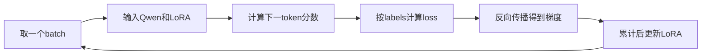

# M3：让模型真正学习凛音的说话方式

本轮run：`m3_tsundere_v3_r8_e2`。已实际训练并完成新进程重载；结果见 [验证记录](M3_验证记录.md)。使用冻结的M2 v3数据，训练360条实例，开发24条，最终测试60条保留到M5。本机使用普通LoRA、MPS和bfloat16，不是4-bit QLoRA。

## 1 和M2最重要的区别

M2整理的是“问题与示范答案”。Tokenizer把它们变成编号，labels指定哪些位置将来要评分；打印assistant或decode标签，得到的仍是我们写好的示范。

M3才会加载基础模型的权重，让它计算下一token的预测分数，用示范答案计算loss，然后更新LoRA参数。训练后的回答需要通过model.generate生成，不能把数据里的assistant字段当成训练结果。

M1已经用12条教学样本验证过训练流程；本轮用360条角色数据独立训练，不接着训练M1 Adapter。

## 2 先认清三个文件

- [训练配置](../configs/m3.json)：规定本轮怎样训练。
- [训练入口](../scripts/m3.py)：校验冻结版本、编码、调用Trainer/PEFT、保存和验证。
- [共用编码](../training_data.py)：保留单轮/多轮历史，只监督最后一条回复。

训练读取 `data/m2/train.jsonl`；开发loss读取 `data/m2/dev_scenarios.jsonl` 的reference_answer。最终测试没有传入Trainer。

新权重在 `outputs/m3_tsundere_v3_r8_e2/adapter/`；训练checkpoint在同一run的 `trainer/`；可阅读记录在 `results/m3_tsundere_v3_r8_e2/`。M1目录和冻结M2文件保留。

## 3 逐条执行

在终端进入项目目录：

```bash
cd "/Users/jakiimo/Desktop/AI Waifu"
```

第一步，检查实际训练输入，不训练模型：

```bash
.venv/bin/python scripts/m3.py inspect-data
```

应看到360条训练、24条开发、60条带前文，以及一条最后回复的监督文字。这里打印的还是示范答案，不是模型回答。完整记录在本轮results目录的 `data_inspection.json`。

第二步，正式训练：

```bash
.venv/bin/python scripts/m3.py train
```

首次运行会加载基础模型、插入LoRA、计算训练前开发loss，再进行2轮训练。终端显示loss、梯度大小、学习率、epoch等日志，每轮计算开发loss并保存checkpoint。

同一个run已经训练完成后，命令会核对产物并返回“未重复训练”，不会覆盖或偷偷再学两轮。若要自己启动另一轮，复制并修改M3配置中的run_id（使用m3_开头的新名字），保存成新实验条件，再训练；不要删除已有结果。

如果你要亲手从头跑并观察训练过程，请使用已经准备的独立学习配置，不需要修改原配置：

```bash
.venv/bin/python scripts/m3.py inspect-data --config configs/m3_learning.json
.venv/bin/python scripts/m3.py train --config configs/m3_learning.json
```

这轮run是`m3_learning_01`，由学习者启动。训练前与每轮结束后，对同一6条开发问题使用short Prompt、贪心解码和128 token生成上限。回答打印到终端并写入`results/m3_learning_01/development_timeline.md`，可以按问题阅读训练前、第1轮、第2轮的变化。参考答案没有传给生成，观察不更新参数。24条开发loss和6条实际生成需要分别看；最终选中的checkpoint会标记在文档中。达到长度上限的回答可能不完整。

后续所有命令也应带`--config configs/m3_learning.json`，才能指向新实验。详细逐步教学见[课程03](../tutorial.md)。

第三步，训练完成后另开一个Python进程重载：

```bash
.venv/bin/python scripts/m3.py verify
```

它从磁盘重新加载基础模型和M3 Adapter，检查预测分数是否与保存前一致、Adapter有没有实际改变分数，并生成一条真实回答。这个命令不是读取示范台词。

第四步，查看开发回答：

```bash
.venv/bin/python scripts/m3.py dev-compare
.venv/bin/python scripts/m3.py status
```

开发观察使用冻结的9个场景和短/详细两种Prompt，共生成18条LoRA回答；原模型回答引用M2的冻结记录。两边使用相同预置消息、模型版本、精度和贪心解码。重复运行会复用当前run的记录。

这些都是开发阶段非盲观察，不是M5最终测试或质量提升结论。完成后的实际状态与数字以 [M3验证记录](M3_验证记录.md) 为准。

## 4 Trainer一轮训练到底做什么



Trainer取样本，用default_data_collator把input_ids、attention_mask、labels堆成张量，再调用模型。它保留我们已经写好的-100标签，不能换成会把所有输入复制到labels的处理方式。

训练输入里确实包含正确答案，这是常见的teacher forcing。因果模型每个位置只能看前面的token，不能看未来的答案；用已知前文预测下一个token，再与真实下一个token比较。这样可以并行训练一整段文字，而不是让它提前偷看后面的答案。

logits是各个候选token的预测分数，交叉熵让正确目标token的概率高时损失小、概率低时损失大。模型内部对齐“前面的位置预测后面的token”。labels=-100的前文与padding不参与loss，最后回复和结束标记参与。

反向传播算出loss对可训练参数的梯度；优化器按梯度和学习率更新参数。PEFT负责插入LoRA并冻结基础权重，Trainer负责训练循环。程序实际检查可训练参数全部属于LoRA，并比较训练前后参数是否变化。

## 5 本轮数字怎么理解

| 配置 | 本轮值 | 含义 |
|---|---:|---|
| num_train_epochs | 2 | 360条实例完整学习两遍，共720次样本处理 |
| batch_size | 1 | 一次前向/反向处理一条 |
| gradient_accumulation_steps | 4 | 累积4次梯度再更新，单设备有效batch为4 |
| 参数更新次数 | 180 | 720次样本处理÷4，完整运行时的计划值 |
| learning_rate | 0.0002 | 控制优化器更新的步幅 |
| warmup_ratio | 0.03 | 开头少量更新逐步升高学习率，再按cosine下降 |
| lora_rank / alpha | 8 / 16 | 适配矩阵的内部维度与缩放配置 |
| lora_dropout | 0.05 | 训练时对LoRA路径使用少量dropout，推理时关闭 |
| max_length | 256 | 输入、目标及padding的固定总长度 |

360条来自120个场景族，同族三种问法共享答案，不能当成360种独立答案；重复两轮也不产生新数据。

只训练q_proj和v_proj位置的LoRA。基础权重存为bfloat16，LoRA可训练参数由PEFT保留为float32。Trainer的fp16/bf16自动混合精度开关关闭，不表示基础权重变成了float32；实际dtype会记录到结果。

## 6 为什么每轮看开发loss

训练loss反映当前模型对训练示范的拟合。开发loss让模型预测未参与参数更新的开发参考答案，仍然是文字预测误差，不是聊天质量评分。

本轮每轮保存checkpoint，并按最低的Trainer eval_loss选择最终Adapter。两轮都训练了，但如果第一轮的开发loss更低，交付的可以是第一轮checkpoint。训练次数与最终选中的checkpoint分别记录。

训练前和训练后开发loss都用同一个Trainer.evaluate、同一批24条开发样本、同一短指令比较。日志里的训练loss是日志窗口统计，不要把某一条训练loss与开发loss当作完全一样的样本指标。

开发集用于选checkpoint，所以不能再当作独立最终成绩。60个测试场景留到M5，不用它们挑epoch或改台词。

## 7 为什么必须保存并另开进程

训练进程里能回答，不等于磁盘文件已经能正确重用。verify重新构造模型再加载Adapter，比较保存前后的预测分数。单看文本相同或不同都不够：分数变化后贪心选出的文字仍可能相同。

本轮还检查禁用Adapter后的基础预测与训练前相符，确认没有把对照模型的基础权重训练掉。Adapter很小，但推理仍需要原基础模型。

## 8 中断与查看进度

训练进行中可以查看本轮results目录的progress.json，或运行：

```bash
.venv/bin/python scripts/m3.py status
```

已有未完成目录时不会静默覆盖。若已经保存完整checkpoint，可恢复：

```bash
.venv/bin/python scripts/m3.py train --resume
```

只恢复同一run、配置、数据、模型和环境。第一个checkpoint保存前中断，没有完整checkpoint就不能假装恢复；保留失败记录，使用新的run_id重新启动。

## 9 学完检查自己是否理解

你应能解释：inspect-data为何没有调用模型也能打印assistant；一次看1条为何有效batch是4；为什么历史能被读取却不参与loss；开发loss下降为什么不能直接宣称角色更好；为什么Adapter加载要用新进程验证。

M3交付的是一次真实训练与可重载的Adapter。M4接聊天界面，M5再用冻结测试集做四组对照与人工评审。

本轮实际输出仍有训话、技术错误和不遵守倾听要求等问题。学习时把训练完成、参数变化、loss下降、回答质量分别判断，阅读原始开发回答，而不只看数字。
